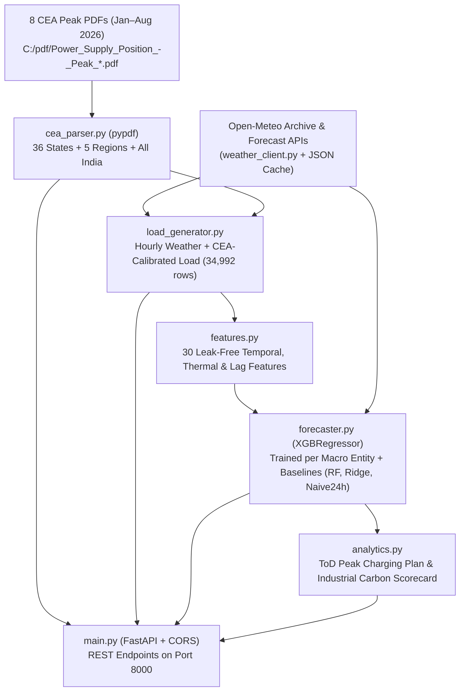

# Smart Grid Energy Consumption Forecaster (Project #58) — Backend Architecture, Math & API Guide

Welcome, **Baka**! This document is the complete technical specification, mathematical reference, empirical benchmark report, and REST API contract for your **FastAPI + XGBoost backend** in `C:\Code Projects\smart-grid-forecaster`.

---

## 1. End-to-End Backend Architecture



### Project Directory Layout (`C:\Code Projects\smart-grid-forecaster`)

| File | Responsibility |
| :--- | :--- |
| `backend/config.py` | 5 Regional Grids (`NR`, `WR`, `SR`, `ER`, `NER`), `All_India`, 36 State-to-Region mappings, ToD tariff multipliers, and CEA CO₂ constants. |
| `backend/cea_parser.py` | Automated `pypdf` extractor for all 8 monthly CEA reports (`2026-01` to `2026-08`), regional diversity calculations, and state peak shortage rankings. |
| `backend/weather_client.py` | Open-Meteo Archive (`Jan 1 – Aug 31, 2026`) + live 7-day Forecast client with disk/TTL caching, What-If temperature/humidity perturbations, and deterministic offline fallback. |
| `backend/load_generator.py` | Physics-and-weather hourly load generator affine-calibrated per month so every region's hourly peak matches its exact CEA Peak Demand MW (`< 0.5 MW` error). |
| `backend/features.py` | Shared feature engineering (`FEATURE_COLUMNS`, 30 features) for both vectorized training (`create_features`) and single-step recursive forecasting (`build_single_step_feature_row`). |
| `backend/forecaster.py` | Chronological train/test split (`Jan 8–Jul 15` train / `Jul 16–Aug 31` test), `XGBRegressor` vs `RandomForest`, `Ridge`, and `Naive24h`, residual `p10/p90` intervals, and state drilldown scaling. |
| `backend/analytics.py` | **Peak Load Charging Visualizer** (Indian MoP Time-of-Day tariff zones & load-shifting optimizer) and **Industrial Carbon Footprint Abatement Scorecard** (marginal emission factor + rooftop solar + BESS simulation). |
| `backend/schemas.py` & `backend/main.py` | Pydantic v2 contracts and FastAPI server with `CORSMiddleware` enabled for React/Vite frontend integration. |
| `tests/test_backend.py` | Automated `pytest` verification for PDF extraction, zero target leakage, XGBoost accuracy thresholds, and all REST endpoints. |

---

## 2. Mathematical Formulations

### 2.1 Cyclical Time & Thermal Feature Engineering (`backend/features.py`)

To preserve continuity across midnight (`23:00 → 00:00`), week boundaries, and seasons:
$$\text{hour\_sin} = \sin\!\left(\frac{2\pi \cdot h}{24}\right), \quad \text{hour\_cos} = \cos\!\left(\frac{2\pi \cdot h}{24}\right)$$
$$\text{dow\_sin} = \sin\!\left(\frac{2\pi \cdot d}{7}\right), \quad \text{dow\_cos} = \cos\!\left(\frac{2\pi \cdot d}{7}\right)$$

Non-linear weather stress is captured via **Cooling Degree Hours (CDH)**, **Heating Degree Hours (HDH)**, and heat-humidity evening interactions:
$$\text{CDH}_{24}(t) = \max(0, T_t - 24.0), \qquad \text{HDH}_{18}(t) = \max(0, 18.0 - T_t)$$
$$\text{temp\_x\_evening}(t) = \text{CDH}_{24}(t) \cdot \mathbb{I}(18 \le h_t \le 22)$$

All autoregressive load features (`load_lag_1h`, `2h`, `3h`, `24h`, `48h`, `168h`, and 24h rolling mean/std/max) are computed on strictly shifted history (`load.shift(1)`), guaranteeing zero target leakage.

### 2.2 XGBoost Regularized Regression Objective (`backend/forecaster.py`)

For each macro grid entity $r \in \{\text{All\_India}, \text{NR}, \text{WR}, \text{SR}, \text{ER}, \text{NER}\}$, `XGBRegressor` learns an additive ensemble of $K = 220$ regression trees minimizing squared error plus L1/L2 leaf regularization:
$$\mathcal{L} = \sum_{i=1}^{N} \left(y_i - \hat{y}_i\right)^2 + \sum_{k=1}^{K} \left(\gamma T_k + \frac{1}{2}\lambda \|w_k\|^2 + \alpha \|w_k\|_1\right)$$

For state-level forecasting (any of the 36 States/UTs $s$ in parent region $r$), the backend runs recursive multi-step forecasting on parent region $r$ and scales by the latest CEA state-to-region peak ratio $\rho_{s,r} = \frac{\text{Peak}^{\text{CEA}}_s}{\text{Peak}^{\text{CEA}}_r}$. Horizon uncertainty bands widen realistically with forecast step $h$:
$$\left[\hat{y}_{t+h}^{\text{p10}}, \, \hat{y}_{t+h}^{\text{p90}}\right] = \left[\hat{y}_{t+h} + q_{0.10}\sqrt{1 + \frac{h}{48}}, \;\; \hat{y}_{t+h} + q_{0.90}\sqrt{1 + \frac{h}{48}}\right]$$

### 2.3 Peak Load Charging & Time-of-Day (ToD) Tariff Rules (`backend/analytics.py`)

Given predicted grid utilization $u_t = \frac{\hat{y}_t}{C_{\text{ref}}}$ and base industrial tariff $B$ (default `₹7.50 / kWh`), each hour receives a ToD multiplier:
- **Critical Surge (`critical_surge`):** $1.30\times$ when $u_t \ge 0.92$ (overrides time window)
- **Solar Rebate (`solar_rebate`):** $0.85\times$ during `09:00–15:59` (`-15%`)
- **Morning Ramp (`morning_ramp`):** $1.10\times$ during `06:00–08:59` (`+10%`)
- **Evening Peak (`evening_peak`):** $1.20\times$ during `18:00–21:59` (`+20%`)
- **Normal (`normal`):** $1.00\times$ otherwise

Daily flexible blocks (`shiftable_mw`) are paired from the highest-cost peak hours to the lowest-cost solar hours on the same calendar date to compute exact ₹ savings.

### 2.4 Industrial Carbon Footprint Abatement Scorecard (`backend/analytics.py`)

Anchored to the **CEA CO₂ Baseline Database** weighted average (`0.716 tCO₂/MWh`), the backend models hourly **Average Grid Emission Factor** $\text{EF}_{\text{avg}}(t) \in [0.54, 0.96]$ (depressed by mid-day solar radiation, elevated by grid utilization stress) and **Marginal Peaker Emission Factor** $\text{EF}_{\text{marg}}(t) \in [0.54, 1.04]$ (`0.94 tCO₂/MWh` during evening peak `18:00–22:00`; `1.04 tCO₂/MWh` during critical grid stress).

Abated emissions combine load shifting (evening peak $\to$ `10:00–14:59` solar window), behind-the-meter rooftop solar, and BESS arbitrage (`90%` round-trip efficiency):
$$\text{CO}_2^{\text{abated}} = \sum_{t=1}^{H} \left(L^{\text{base}}_t \cdot \text{EF}_{\text{avg}}(t) - \max\!\left(0, \, L^{\text{base}}_t \cdot \text{EF}_{\text{avg}}(t) - (L^{\text{base}}_t - L^{\text{opt}}_t)\cdot \text{EF}_{\text{marg}}(t)\right)\right)$$

---

## 3. Observed Empirical Dataset Audit & XGBoost Benchmarks (Review 2 Ready)

All figures below were measured directly from `C:\Code Projects\smart-grid-forecaster` after running `pytest` on **2026-11-24**:

### 3.1 Dataset Audit (`All_India`, Jan 1 – Aug 31, 2026)
- **Total Multi-Region Dataset:** `34,992` hourly rows (`5,832` hours × `6` macro entities: `All_India`, `NR`, `WR`, `SR`, `ER`, `NER`), `9` raw columns, **0 duplicate timestamps**, **0 missing values**.
- **All-India Hourly Load Stats:** Mean = `204,732.27 MW`, Std = `31,292.89 MW`, Min = `128,974.26 MW`, Median (`p50`) = `212,777.89 MW`, `p95` = `247,556.26 MW`, Max = `270,832.00 MW` (exact May 2026 CEA peak), Load Factor = `75.59%`.
- **Weather-Load Pearson Correlations (`All_India`):** `temperature_2m`: **`+0.4621`**, `relative_humidity_2m`: **`-0.4316`**, `apparent_temperature`: **`+0.4070`**, `wind_speed_10m`: `+0.3804`, `shortwave_radiation`: `+0.3728`, `precipitation`: `+0.0065`.

### 3.2 Holdout Evaluation Benchmarks (`Train: 4,536 hrs` | `Test: 1,128 hrs`, Jul 16 – Aug 31, 2026)

| Region | Model | MAE (MW) | RMSE (MW) | MAPE (%) | R² | Daily Peak MAPE (%) | Peak Timing Hit (±1h) | Peak Alert F1 |
| :--- | :--- | ---: | ---: | ---: | ---: | ---: | ---: | ---: |
| **All_India** | **XGBoost** | **2,292.80** | **2,971.30** | **1.109%** | **0.9909** | **0.794%** | **97.9%** | **0.9113** |
| All_India | RandomForest | 2,859.19 | 3,702.08 | 1.377% | 0.9858 | 0.948% | 97.9% | 0.8682 |
| All_India | Ridge | 3,240.12 | 4,196.16 | 1.599% | 0.9818 | 1.060% | 97.9% | 0.8916 |
| All_India | Naive24h | 6,512.70 | 8,277.40 | 3.178% | 0.9290 | 2.668% | 97.9% | 0.7449 |
| **NR** | **XGBoost** | **1,381.67** | **1,773.83** | **2.204%** | **0.9732** | 1.591% | 95.7% | **0.9054** |
| NR | Naive24h | 3,488.44 | 4,371.50 | 5.506% | 0.8375 | 5.210% | 89.4% | 0.7059 |
| **WR** | **XGBoost** | **1,116.24** | **1,460.15** | **1.850%** | **0.9740** | 1.282% | **91.5%** | **0.8615** |
| **SR** | **XGBoost** | **886.62** | **1,228.29** | **1.641%** | **0.9765** | 1.192% | **83.0%** | **0.8110** |
| **ER** | **XGBoost** | **486.40** | **631.92** | **1.858%** | **0.9800** | 1.376% | 93.6% | **0.8624** |
| **NER** | **XGBoost** | **53.37** | **69.66** | **1.844%** | **0.9834** | **1.621%** | **100.0%** | **0.9069** |

---

## 4. Running the Backend & REST API Reference

### Start the Server
```powershell
cd "C:\Code Projects\smart-grid-forecaster"
python -m uvicorn backend.main:app --reload --port 8000
```
Interactive Swagger UI will be available at `http://localhost:8000/docs`.

### Endpoint Summary (for React / Vite Frontend)

| Method & Path | Query / JSON Body | What It Returns |
| :--- | :--- | :--- |
| `GET /api/v1/health` | — | Service status, loaded CEA months (`2026-01`..`2026-08`), state count (`36`), total dataset rows (`34,992`). |
| `GET /api/v1/regions` | — | Metadata for all `6` macro entities (`All_India`, `NR`, `WR`, `SR`, `ER`, `NER`) and all `36` States/UTs/DVC with 2026 peak & shortage stats. |
| `GET /api/v1/cea/summary` | `?entity=All_India` *(or region/state)* | Official 8-month CEA peak series, regional non-coincident grid diversity table, top 15 state shortage events, and CEA data notes. |
| `GET /api/v1/dataset/audit` | `?region=All_India` *(macro only)* | EDA audit stats (row/col counts, nulls, duplicates, load summary, weather correlations, monthly CEA calibration check). |
| `GET /api/v1/models/metrics` | `?region=All_India` *(macro only)* | Holdout comparison (`XGBoost`, `RandomForest`, `Ridge`, `Naive24h`), top 12 feature importances, and 168h actual-vs-predicted holdout sample. |
| `GET` / `POST /api/v1/forecast` | `{"entity":"NR","horizon_hours":48,"temp_delta_c":4.0,"humidity_delta_pct":10.0}` | Recursive multi-step hourly forecast (`predicted_mw`, `lower_bound_mw`, `upper_bound_mw`, weather drivers, `utilization_pct`, `is_flagged_peak`). Supports any of the 36 states too (e.g., `"Karnataka"`). |
| `POST /api/v1/analytics/peak-charging` | `{"entity":"NR","horizon_hours":48,"base_tariff_inr":7.5,"shiftable_mw":10.0}` | Hourly ToD tariff schedule (`solar_rebate`, `normal`, `morning_ramp`, `evening_peak`, `critical_surge`), baseline vs optimized INR cost, and peak-to-solar shift recommendations. |
| `POST /api/v1/analytics/carbon-scorecard` | `{"entity":"All_India","horizon_hours":48,"facility_mw":12.0,"shiftable_pct":30.0,"solar_capacity_mw":3.0,"battery_capacity_mwh":6.0}` | Hourly grid/marginal emission factors, BESS + solar + load-shift dispatch trace, `abated_tco2`, `annualized_abated_tco2`, INR savings, coal avoided, equivalent trees, and grade (`A+`..`D`). |
